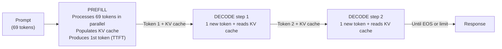
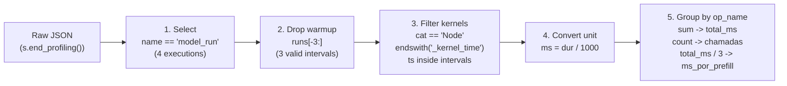
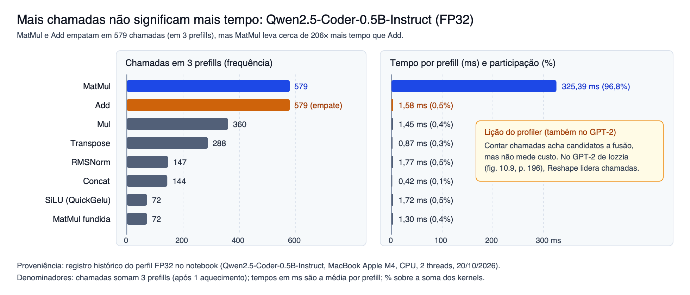

# Measurement and Profiling

There is no universal parameter threshold that defines a **Small Language Model (SLM)**: the boundary depends on the deployment context. Whether a model fits "modest hardware" depends on available RAM, weight precision, context length, and target latency.

## The Qwen Case and Reference Task

In Section 1 of the notebook, we use [`Qwen/Qwen2.5-Coder-0.5B-Instruct`](https://huggingface.co/Qwen/Qwen2.5-Coder-0.5B-Instruct) (`~0.49B` total parameters, pinned revision `ea3f2471cf1b1f0db85067f1ef93848e38e88c25`) on CPU with `2` threads. We ask the model to write only Python code defining `media(numeros)` to return the arithmetic mean of a list and `0.0` when empty, without imports. In the historical record of **20 Oct 2026**, the formatted chat prompt had **69 tokens**, and PyTorch FP32 replied in **36 tokens** (including Markdown fences and the stop token):

```python
def media(numeros):
    if not numeros:
        return 0.0
    return sum(numeros) / len(numeros)
```

This baseline passed all seven initial test cases (`[2, 4, 6]`, `[]`, `[-2, 2]`, `[1.5, 2.5]`, `[7]`, `[-6, -3]`, and `[0.1, 0.2]`), checked with `np.isclose` because in IEEE 754 binary floating-point arithmetic `0.1 + 0.2` equals `0.30000000000000004`, not `0.3`.

### Greedy Decoding and the `repetition_penalty` Difference

Although generation uses `do_sample=False` (deterministic decoding with `temperature` and `top_p` neutralized to `1.0`), **PyTorch and the ONNX validation loop do not apply the same token-selection rule in the notebook**:
- In Section 1, `modelo.generate(do_sample=False, max_new_tokens=128)` inherits **`repetition_penalty=1.05`** from the model's published `generation_config.json`, which rescales logits of previously seen tokens before picking the maximum. It stops at either declared end-of-sequence (**EOS**) token: `151645` (`<|im_end|>`) or `151643` (`<|endoftext|>`).
- In Section 7 ([Output validation and limits](validation.md)), the ONNX loop picks raw `argmax` **without** `repetition_penalty`, stopping at the same two EOS IDs or at `128` new tokens.

Never compare the text from PyTorch `generate` (with penalty) against the ONNX loop (without penalty). The behavioral check compares **ONNX FP32 against ONNX INT8** under identical prompts and rules.

## Prefill, Decode, KV Cache, and Measured Scopes

Autoregressive generation splits into two phases with distinct computational profiles:



During **prefill**, all 69 prompt tokens enter in parallel through dense matrix multiplications to produce the first token. During **decode**, the model generates **one token per step**; the **KV cache** (`use_cache=True` in PyTorch) stores past Key and Value projections so the model does not recompute the entire prefix at every step.

The notebook separates three measurements with different roles:
1. **Full PyTorch generation (`Medir a geração completa`):** generates exactly `32` new tokens (`min_new_tokens=32, max_new_tokens=32`, `use_cache=True`) to avoid early stopping. Historical median (20 Oct 2026): **1,594.7 ms**.
2. **Exported ONNX prefill (`Exportar o prefill para ONNX e conferir a saída`):** exports prefill **once** without KV cache (`use_cache=False`) using a dynamic sequence axis (`dynamic_axes`), checking logits against PyTorch at **two lengths** (`69` and `68` tokens, `rtol=1e-3, atol=1e-3`) while the PyTorch model is still loaded. Every timing and profiling cell still runs on the fixed `69`-token prompt (`feed`), while the dynamic axis lets Section 7 reuse the same graph without re-exporting. In the fixed-shape 20 Oct 2026 record, `qwen_fp32.onnx` totaled **2,521.3 MB** (graph plus external weights), matched PyTorch within `1e-3`, and had an isolated median of **361.56 ms**.
3. **Full ONNX generation (`Gerar com FP32 e INT8 e avaliar as três tarefas`):** reuses the dynamic FP32 prefill and INT8 graph by recomputing the whole sequence on every token (**no KV cache**). It validates output behavior only and never measures realistic decode latency.

Speeding up prefill does not automatically carry over to KV-cached decode, where repeatedly reading weights and KV tensors from memory weighs more heavily (see [Beyond the book](beyond-the-book.md)). These experiments time a single request at a time. **TTFT** (time to first token) and **TPOT** (time per output token) are useful latency metrics, but the notebook does not collect them separately. Its full-generation timer and prefill timer also do not measure aggregate serving throughput under concurrent load.

<details>
<summary>Architecture and export notes: Qwen2.5-Coder-0.5B-Instruct vs. GPT-2</summary>

While Chapter 10 of Iozzia uses **GPT-2** (2019, `LayerNormalization` and `Gelu`), `Qwen2.5-Coder-0.5B-Instruct` has:
- `~0.49B` total parameters (`~0.36B` non-embedding; `tie_word_embeddings: true`, `vocab_size = 151,936`, `hidden_size = 896`);
- `24` Transformer layers with **Grouped-Query Attention (GQA)** (`14` query heads, `2` KV heads), **RMSNorm**, **SwiGLU** (SiLU activation, `x * sigmoid(x)`), **RoPE**, and context up to `32,768` tokens.

Those 24 layers directly explain the fused counts seen in [Optimization](optimization.md): `24 QuickGelu`, `24 FusedMatMul`, and `49 SimplifiedLayerNormalization` (`2 * 24 + 1` final norm), replacing `SkipLayerNormalization` and `FastGelu` from GPT-2.

ONNX Runtime sessions pin `intra_op_num_threads = 2` and `inter_op_num_threads = 1` on `CPUExecutionProvider`. The single FP32 export is stored in `fp32/` so the optimized graph can reference the same external weight files without copying them, using `dynamo=False` to force the TorchScript exporter. On Linux/glibc, `liberar_memoria()` combines `gc.collect()` with `malloc_trim(0)` when available to curb RAM retention between stages (no guarantee on macOS or Windows).
</details>

## Robust Paired Timing

On a shared CPU, thermal throttling and background tasks add noise. The notebook applies three safeguards:
1. **Discard warmup runs:** the first call pays one-off allocation and cold-cache costs (`1` warmup before `3` PyTorch runs; `2` per session before `8` rounds in `pareado()`; `1` before `3` measured runs in `perfilar()`).
2. **Use the median and inspect min/max:** one system spike skews the mean. Across the three 20 Oct 2026 PyTorch generation samples (`1488.8`, `1594.7`, and `4607.9 ms`), the mean jumps to **2,563.8 ms** (`+60.8%`), while the median stays at **1,594.7 ms**.
3. **Interleave variants in paired rounds:** `pareado()` alternates execution order across `N = 8` rounds (`A, B` on even rounds; `B, A` on odd rounds). Alongside the ratio of medians, the consolidated notebook computes the **median of paired block ratios** (`razao_pareada()`), pairing each consecutive `(A, B)` and `(B, A)` round into a balanced block `(A_even + A_odd) / (B_even + B_odd)` and taking the median across the four blocks. Interleaving reduces order bias, though it cannot eliminate external load bursts.

```python
def pareado(sessoes, feed, repeticoes=N, aquecimentos=2):
    """Warm up each session and time interleaved rounds (A,B / B,A / ...)."""
    tempos = {nome: [] for nome in sessoes}
    for s in sessoes.values():
        for _ in range(aquecimentos): s.run(None, feed)
    nomes = list(sessoes)
    for i in range(repeticoes):
        for nome in (nomes if i % 2 == 0 else nomes[::-1]):
            inicio = time.perf_counter(); sessoes[nome].run(None, feed)
            tempos[nome].append((time.perf_counter() - inicio) * 1000)
    tabela = pd.DataFrame([{'variante': nome, 'mediana_ms': np.median(t), 'min_ms': min(t), 'max_ms': max(t), 'n': len(t)}
                           for nome, t in tempos.items()]).set_index('variante')
    tabela.attrs['amostras'] = tempos
    return tabela

def razao_pareada(tabela, numerador, denominador):
    """Median of ratios across blocks of two consecutive rounds with opposite orders."""
    a, b = (np.asarray(tabela.attrs['amostras'][v]) for v in (numerador, denominador))
    if len(a) % 2:
        raise ValueError('Use um número par de rodadas: cada bloco junta as ordens A,B e B,A.')
    return float(np.median(a.reshape(-1, 2).sum(1) / b.reshape(-1, 2).sum(1)))
```

In the **20 Oct 2026** historical record, the **exact same optimized FP32 prefill** yielded widely different medians at three separate moments:

| Moment in historical record (20 Oct 2026) | FP32 median (ms) | Min (ms) | Max (ms) |
|---|---:|---:|---:|
| Isolated check after export | 361.56 | not printed | not printed |
| Paired `Sem otimizações` vs. `Com otimizações` | 382.79 | 335.25 | 677.17 |
| Paired `FP32` vs. `INT8` | 585.24 | 372.33 | 1,571.20 |

Cross-comparing latencies from separate sessions produces invalid ratios; compare variants only when interleaved in the same paired run.

## Reading the ONNX Runtime Profiler

Enabling `enable_profiling = True` on a dedicated session writes a Chrome Tracing JSON file (also viewable in Perfetto UI). Each event stores `cat` (`"Session"` for coarse phases like `model_run`; `"Node"` for graph operators), `name` (compiled kernels end in `_kernel_time`), `ts` and `dur` in **microseconds (`us`)**, and `args.op_name`.

Sample recorded event (20 Oct 2026):

```text
{'cat': 'Node', 'name': '/modelo/model/embed_tokens/Gather_kernel_time', 'dur': 24}
Operador: Gather · dur em microssegundos
```

Three rules prevent profiling misreads:
1. **Convert units:** divide `dur` by `1,000` to obtain milliseconds (`24 us = 0.024 ms`; Iozzia Figures 10.8 and 10.13 label axes `ms` over microsecond values).
2. **Never sum `Session` and `Node` events:** `model_run` encloses the nodes; adding both double-counts work.
3. **Filter post-warmup runs and declare denominators:** `resumir_perfil()` keeps only `_kernel_time` events inside the timestamps of the last `3` `model_run` intervals (`runs[-3:]`).

```python
def resumir_perfil(eventos, medidas):
    """Group by operator only the kernels inside the last `medidas` runs; `dur` is in microseconds."""
    runs = sorted((e for e in eventos if e.get('cat') == 'Session' and e.get('name') == 'model_run'), key=lambda e: e['ts'])
    if len(runs) < medidas + 1:
        raise ValueError(f'Perfil com {len(runs)} execuções; esperado aquecimento + {medidas} medidas.')
    intervalos = [(e['ts'], e['ts'] + e['dur']) for e in runs[-medidas:]]
    kernels = [e for e in eventos if e.get('cat') == 'Node' and e.get('name', '').endswith('_kernel_time')
               and any(a <= e['ts'] < b for a, b in intervalos)]
    if not kernels:
        raise ValueError('Nenhum evento de kernel dentro das execuções medidas.')
    tabela = pd.DataFrame([{'operador': e['args']['op_name'], 'ms': e['dur'] / 1000} for e in kernels])
    resumo = tabela.groupby('operador').agg(total_ms=('ms', 'sum'), chamadas=('ms', 'count'))
    resumo['ms_por_prefill'] = resumo.total_ms / medidas
    resumo['participacao_%'] = 100 * resumo.total_ms / resumo.total_ms.sum()  # denominator: measured kernel sum
    return resumo.sort_values('total_ms', ascending=False), kernels
```



Historical optimized FP32 operator profile (**20 Oct 2026**, fixed shape, 3 measured prefills):

| Operator (`args.op_name`) | Mean per prefill (`total_ms / 3`) | Calls (in 3 prefills) | Calls per prefill (`chamadas / 3`) | Share of kernels (`%`) |
|---|---:|---:|---:|---:|
| `MatMul` | 325.39 ms | 579 | 193 | 96.77% |
| `SimplifiedLayerNormalization` (RMSNorm) | 1.77 ms | 147 | 49 | 0.53% |
| `QuickGelu` (SiLU) | 1.72 ms | 72 | 24 | 0.51% |
| `Add` | 1.58 ms | 579 | 193 | 0.47% |
| `Mul` | 1.45 ms | 360 | 120 | 0.43% |
| `FusedMatMul` | 1.30 ms | 72 | 24 | 0.39% |
| `Transpose` | 0.87 ms | 288 | 96 | 0.26% |
| `Concat` | 0.42 ms | 144 | 48 | 0.13% |

Dividing call counts by `3` recovers the exact optimized-graph operator counts per prefill (`193 MatMul`, `49 SimplifiedLayerNormalization`, `24 QuickGelu`, `24 FusedMatMul`). The denominator of `participacao_%` is always the sum of filtered kernels in those 3 runs, never the external timer.

**Profiler versus external timer:** summing all filtered kernels gives `325.39 / 0.9677` (`~336.25 ms/prefill`). Although smaller than the `361.56 ms` isolated timer after export, **that gap cannot be attributed quantitatively to runtime overhead**: the two numbers come from **different sessions** (profiled vs. unprofiled) and **different statistics** (3-run mean vs. 8-run median at another moment). Wall-clock time does include work outside kernels (Python/C++ call boundary, buffers, dispatch, scheduling), but subtracting numbers from separate sessions mixes that cost with host variance.

## Call Frequency Versus Accumulated Cost

In the table above, `Add` and `MatMul` tie at **579 calls** (`193` per prefill), yet `MatMul` consumes **325.39 ms/prefill (96.77%)** while `Add` takes **1.58 ms/prefill (0.47%)**, a roughly **206x** gap for the exact same call count.



*Historical chart recorded on 20 Oct 2026 (Apple M4 CPU, fixed-shape FP32 prefill); plotted axis and panel labels remain in Portuguese as originally generated.*

**Pause and interpret:** if `Add` and `MatMul` have the same call count per prefill, what decision follows from the calls column, and what decision follows from the time column?

<details>
<summary>Check answer</summary>

Call counts flag repetitive operators that may be candidates for graph fusion (like `Reshape` in Iozzia's GPT-2 example, Fig. 10.9, p. 196). Accumulated time identifies the real latency bottleneck: here, matrix multiplications dominate almost all kernel execution time, which guides the optimization steps in [Graph optimization, INT8, and FP16](optimization.md).
</details>
