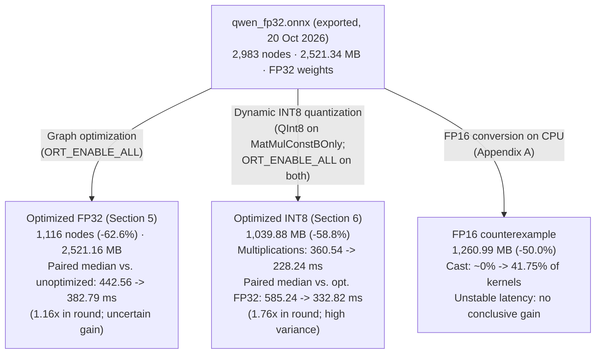
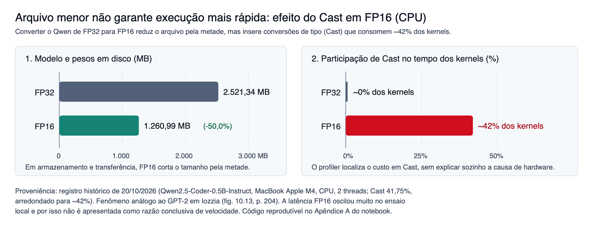

# Graph Optimization, INT8 Quantization, and FP16 on CPU

Once the profiler shows where kernel time goes, **Amdahl's Law** ([Amdahl, AFIPS 1967](https://doi.org/10.1145/1465482.1465560)) bounds the overall speedup `S` when speeding up a fraction `f` of execution time by a factor `k`, holding the remaining time `(1 - f)` constant:

```text
S = 1 / ((1 - f) + f / k)
```

Applying this formula to the **already-optimized FP32 profile** from [Measurement](measurement.md) (historical record of **20 Oct 2026**), where matrix multiplications (`MatMul` `96.77%` + `FusedMatMul` `0.39%`) account for `f = 0.9716` (`97.16%`, displayed as `97.2%`):
- Doubling multiplication speed (`k = 2`), holding the remaining time constant, gives `S = 1 / (0.0284 + 0.9716 / 2)` = `1.94x` on total kernel time.
- Eliminating all other operators (`2.84%`, `k -> infinity`), holding multiplication time constant in that same reference profile, yields at most `S = 1 / 0.9716` = `1.03x`.

**Pause and interpret:** starting from that already-optimized profile (`f = 97.16%`), what is the ceiling on kernel speedup if a new change touches only the remaining `2.84%` without shortening multiplication time? And why does keeping weights in FP32 **not** by itself guarantee that multiplication time stays invariant?

<details>
<summary>Check answer</summary>

If multiplication time stays unchanged in that reference profile, the kernel-time ceiling is **`1.03x`**, even if the peripheral `2.84%` dropped to zero. Amdahl's condition is about the **execution time** of the dominant part remaining constant, not its numeric type (`dtype`): layout transformations, CPU kernel selection, or fusions can speed up `MatMul` even while keeping FP32 weights.
</details>

## Three Distinct ONNX Runtime Interventions

Graph optimization and quantization operate at different layers and are combined by default in ONNX Runtime (both the FP32 and INT8 sessions in Section 6 run with online `ORT_ENABLE_ALL` enabled). The diagram summarizes the **20 Oct 2026** fixed-shape historical record:



## Part A: Graph Optimization (`ORT_ENABLE_ALL`)

Graph optimization rewrites the structure of operations while preserving FP32 weights ([ONNX Runtime Graph Optimizations](https://onnxruntime.ai/docs/performance/model-optimizations/graph-optimizations.html)). Under `ORT_ENABLE_ALL`, the runtime combines constant folding, redundant node elimination, **operator fusion** (merging consecutive nodes into one kernel to reduce intermediate RAM traffic), and CPU-oriented layout rewrites. This runs **online** at session startup or can be saved **offline** via `optimized_model_filepath` (placed inside the same `fp32/` folder so it references the original external weight files without duplicating them) and reloaded with `ORT_DISABLE_ALL` on the same hardware and execution provider.

Historical record (**20 Oct 2026**, MacBook M4, fixed-shape 69-token graph):

| Metric (20 Oct 2026 historical record) | Without optimizations (`ORT_DISABLE_ALL`) | With optimizations (`ORT_ENABLE_ALL`) |
|---|---:|---:|
| Graph nodes | 2,983 | 1,116 (-62.6%) |
| `MatMul` nodes (+ `FusedMatMul`) | 218 (+ 0) | 193 (+ 24) |
| Referenced model size (MB) | 2,521.34 | 2,521.16 |
| Paired median latency (ms) | 442.56 | 382.79 (1.16x) |
| Min / max latency (ms) | 334.87 / 1,011.94 | 335.25 / 677.17 |
| Output check on 69-token prompt | Reference | Logits within `1e-3`; identical next token |

Two methodological caveats prevent over-interpreting this table:
1. **Uncertain gain and no causal attribution without a before/after profile:** the nearly tied minimums (`334.87` vs. `335.25 ms`) and high maximums show that part of the median gap can be run noise. Because the 20 Oct 2026 log did not capture separate operator profiles for `ORT_DISABLE_ALL` vs. `ORT_ENABLE_ALL`, we do not assign the `1.16x` ratio to specific operators.
2. **Amdahl applies forward from the same profile condition:** the `97.16%` multiplication share was measured on the **already-optimized** graph, so it must not be applied retroactively as a bound on the unoptimized-to-optimized jump. Instead, it bounds what comes next from that profile: cutting more non-`MatMul` nodes without reducing multiplication time hits a `1.03x` ceiling. Node count is not execution cost; in the **25 Nov 2026** dynamic-graph Linux run, dropping `5,885 -> 2,581` nodes left the paired median at `330.10 -> 328.06 ms` (`1.01x`), examined in [Beyond the book](beyond-the-book.md).

<details>
<summary>Concrete Qwen2.5 fusions, GPT-2 contrast, and ReferenceEvaluator</summary>

Inspecting `qwen_fp32.onnx` and `qwen_otimizado.onnx` with `load_external_data=False` (avoiding a 2.5 GB RAM load) reveals three fusions tied directly to Qwen's 24 layers:

| Pattern in exported ONNX | Fused operator | Occurrences | Role in Qwen2.5-Coder-0.5B |
|---|---|---:|---|
| `Sigmoid(x)` + `Mul(x, ...)` | `QuickGelu` (`alpha = 1`) | 24 | SiLU activation, 1 per layer |
| RMSNorm subgraph | `SimplifiedLayerNormalization` | 49 | 2 per layer + 1 final norm |
| Transpose + attention + scale (`alpha = 0.125`) | `FusedMatMul` | 24 | 1 attention fusion per layer |

In Iozzia's **GPT-2** (§10.3, pp. 202-204), the corresponding fusions are `SkipLayerNormalization` and `FastGelu`. The same section introduces `onnx.reference.ReferenceEvaluator`, a didactic Python executor useful for inspecting tensors node by node when debugging small graphs.
</details>

## Part B: Dynamic INT8 Quantization

To target the ~97% multiplication share, `quantize_dynamic` ([ONNX Runtime Quantization](https://onnxruntime.ai/docs/performance/model-optimizations/quantization.html)) converts eligible FP32 weights into signed 8-bit integers (`QuantType.QInt8`) plus scale factors. During inference, **activations** are dynamically quantized to `uint8`, multiplied in integer arithmetic, and rescaled back to FP32. The notebook restricts conversion to `op_types_to_quantize=['MatMul']` with `extra_options={'MatMulConstBOnly': True}`, quantizing only projections whose second operand (`B`) is a constant weight tensor while leaving activation-by-activation multiplications (such as attention products) in floating point. Both compared sessions (FP32 and INT8) run with `ORT_ENABLE_ALL` active.

Historical record (**20 Oct 2026**, MacBook M4, fixed-shape graph):

| Measurement in 20 Oct 2026 record | FP32 (optimized) | Dynamic INT8 (optimized) | Ratio / delta |
|---|---:|---:|---|
| Referenced model size (MB) | 2,521.34 | 1,039.88 | -58.8% |
| Profile: `Multiplicações` (ms/prefill) | 360.54 | 228.24 | 1.58x |
| Profile: `Quantização` (ms/prefill) | 0.00 | 0.95 | +0.95 ms |
| Profile: `Demais operações` (ms/prefill) | 11.00 | 9.27 | -1.73 ms |
| Paired timer median, no profiler (ms) | 585.24 | 332.82 | 1.76x |
| Paired timer min / max (ms) | 372.33 / 1,571.20 | 242.43 / 465.41 | High FP32 variance |

*Notes on the table:* the FP32 operator-family profile (`360.54 ms`) was collected in Section 6 alongside INT8, which is why it differs from the `326.69 ms` multiplication total in Section 3. Fused integer kernels such as `DynamicQuantizeMatMul` count their internal activation conversion inside `Multiplicações`.

**Numerical effect:** all INT8 logits remained finite (no `NaN` or infinity), but the mean absolute difference reached **`1.2511`**, enough to flip the predicted **next token**: FP32 selected ``'```'`` (ID `73594`) while INT8 selected `'def'` (ID `750`). That shift triggers the full-generation check in [Output validation and limits](validation.md).

**Why did Amdahl (`1.55x`) differ from the paired timer (`1.76x`)?**
With `f = 0.97` and `k = 360.54 / 228.24` (`~1.58`), Amdahl yields `1 / (0.03 + 0.97 / 1.58)` = `1.55x`. Four factors explain the gap:
1. This calculation is a retrospective decomposition using before/after profiles, not an independent forecast.
2. Non-multiplication time did not stay fixed (`11.00 -> 9.27 ms`) and `0.95 ms` appeared in explicit `Quantização`.
3. Reading weights from RAM **occurs inside the multiplication kernels** (shrinking weights to 8 bits can shorten multiplication kernel time when memory traffic limits performance), whereas the external timer runs in a separate unprofiled session and measures total wall-clock time (including dispatch, buffer copies, and Python/C++ call overhead) using a different statistic (8-run median vs. 3-run mean).
4. The historical FP32 run had wide dispersion (`372.33` to `1,571.20 ms`). High variance **does not prove that `1.76x` was inflated**; it means the exact magnitude is **uncertain** without tighter host control and paired block-ratio analysis (`razao_pareada()`).

<details>
<summary>Why is the INT8 model 1,040 MB instead of ~630 MB?</summary>

Moving from 32 to 8 bits suggests a 75% reduction, yet file size dropped `58.8%`. A structural consistency estimate from `config.json` (not a per-tensor disk measurement) accounts for the gap:
- `tie_word_embeddings: true` shares the embedding table (`151,936 * 896` = `136,134,656` parameters, `~544.5 MB` in FP32) between input lookup (`Gather`) and the output projection (`lm_head`).
- The exported total is consistent with an additional embedding-sized FP32 matrix (`~0.63B` stored values * 4 bytes `~2,521 MB`). This is a size-consistency explanation, not a verified per-tensor storage inventory.
- Under that approximation, retaining an embedding-sized FP32 lookup table (`~544.5 MB`) while storing roughly 494M eligible values at one byte each (`~494 MB`) gives a total near the observed `1,039.88 MB` (decimal MB, `10^6` bytes). A per-tensor inspection would be needed to establish the exact split and overhead.
</details>

## Part C: The FP16 Counterexample on CPU

Fewer bits per weight do not guarantee faster inference. In the **20 Oct 2026** historical record (reproducible via optional Appendix A), converting the Qwen graph to FP16 on CPU cut file size almost in half (**`-50.0%`**, from `2,521.34` to `1,260.99 MB`), but the **`Cast`** operator (converting tensors between FP16 and FP32) jumped from `~0%` to **`41.75%`** (`~42%`) of total kernel time.



*Historical chart recorded on 20 Oct 2026 (Apple M4 CPU, fixed-shape FP32 vs. FP16); plotted axis and panel labels remain in Portuguese as originally generated.*

This mirrors the **GPT-2** result in Iozzia (Fig. 10.13, p. 204), where `Cast` also rises to the top after FP16 conversion. The profiler pinpoints the cost in `Cast` (without alone proving the underlying CPU microarchitectural cause), and wall-clock latency fluctuated too heavily to claim a stable speedup. Moreover, on **25 Nov 2026** inside the 6.5 GiB Linux container, FP16 conversion ran out of memory (`oom_kill=1`). A smaller file saves disk space and memory transfer volume, yet only timing and profiling on the target hardware prove a speedup.

<details>
<summary>Appendix A conversion options: keep_io_types and disable_shape_infer</summary>

The optional FP16 cell calls `convert_float_to_float16(keep_io_types=True, disable_shape_infer=True)`. Setting `keep_io_types=True` keeps the original input and output types intact (token IDs and attention mask remain `INT64`; output logits remain `FP32`) so the calling interface does not change. Setting `disable_shape_infer=True` prevents shape-inference failures on large models using external data files.
</details>
