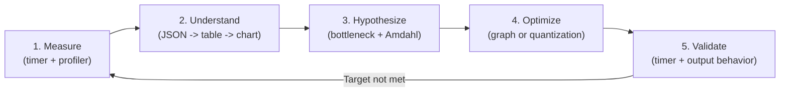

# Profiling and Optimizing Small Language Models on CPU

Suppose you deploy a compact language model locally on CPU to generate Python functions. In one historical setup, the generated code worked, yet a short response took nearly two seconds. Without measuring what happens inside the runtime, optimization becomes guesswork: you can cut the model file size in half and slow inference down, or eliminate thousands of computation-graph nodes and gain almost nothing.

This self-guided practice module accompanies the runnable notebook [`slm-python-profiling.ipynb`](https://github.com/luizpaulobarroca/IAG-2026-SLM/blob/docs/slm-profiling-wiki-20261125/notebooks/profiling/slm-python-profiling.ipynb) (code, identifiers, and prose in Portuguese) in the *Generative AI* course. It applies Chapter 10 (and dynamic quantization concepts from Chapter 7) of Guglielmo Iozzia's *Domain-Specific Small Language Models* (Manning, 2026) to `Qwen/Qwen2.5-Coder-0.5B-Instruct` running on ONNX Runtime CPU. The core path follows the closed loop **measure -> understand -> optimize -> validate**, and then moves beyond the book to investigate **why** an optimization helps or fails by connecting local timings to testable hypotheses about memory traffic, hardware, and multi-objective trade-offs.

## Prerequisites and CPU Setup

**Prerequisites:** basic Python (functions, lists, dictionaries, and `pandas`), familiarity with matrix multiplication, and an introductory grasp of Transformers (tokens, layers, and autoregressive generation).

**Environment and resource budget:**
- **Hardware:** CPU only; no GPU is used at any step. Run all cells in order without skipping.
- **Validated library versions:** the recorded experiments use `transformers==4.46.3`, `onnx==1.17.0`, `onnxruntime==1.20.1`, `numpy==1.26.4`, `pandas==2.2.3`, `matplotlib==3.9.2`, and `torch==2.5.1`. ONNX export explicitly selects the TorchScript exporter (`dynamo=False`) because newer PyTorch versions changed the default exporter.
- **Disk and RAM budget:** the Hugging Face model download is roughly `1 GB`. Exported ONNX artifacts total roughly `3.5 GB` (`~2.5 GB` for the dynamic FP32 prefill plus `~1.0 GB` for dynamic INT8; the optimized FP32 graph reuses the external weight files inside `fp32/` without duplicating them), plus `~1.3 GB` if you run the optional FP16 appendix. Peak memory during quantization and paired FP32 vs. INT8 comparisons requires several gigabytes of RAM. The setup cell installs the listed non-PyTorch packages, while PyTorch comes from the environment and is checked against the recorded version. If installing NumPy changes its version, restart the notebook session before continuing; this material has not been validated against every newer PyTorch or Colab environment.

> **Provenance and validation status of experimental numbers**
>
> Two distinct local executions appear in this module and must never be treated as controlled repeats of one another:
> - **Historical record (20 Oct 2026):** executed locally on an Apple M4 MacBook (`arm64`, Darwin, CPU, 2 threads, Python 3.11.17, PyTorch 2.5.1, Transformers 4.46.3, ONNX 1.17.0, ONNX Runtime 1.20.1) on an ONNX prefill exported with **fixed shapes** (`69` tokens). These values are preserved in Appendix B of the notebook and anchor the baseline tables and historical figures in [Measurement](measurement.md) and [Optimization](optimization.md).
> - **Consolidated execution (25 Nov 2026):** the consolidated notebook exports the prefill **once with a dynamic sequence axis (`dynamic_axes`)** and reuses that same FP32 graph and its INT8 quantized counterpart across all three validation tasks. All **14/14 main-path cells** completed with the real Qwen model inside a virtualized local Linux ARM64 container (6.5 GiB RAM limit, no swap, Python 3.11.18, same library versions). **The optional FP16 appendix failed** by exceeding the 6.5 GiB memory ceiling (`oom_kill=1`, exit code `-9`), so the full notebook including FP16 remains incomplete under a 6.5 GiB budget.
>
> Neither run verifies execution on Google Colab. Multi-objective Pareto examples in [Exercises](exercises.md) are explicitly hypothetical. Older course notes citing CodeGen refer to a different version of the class.

## The Optimization Cycle

Timing an inference call with `time.perf_counter()` reports total wall-clock duration, not where time went. An internal **profiler** records how much time each operator (*kernel*, the compiled routine executing an op on CPU) consumed inside the computation graph. The external timer answers *"is it slow?"*; the profiler answers *"what is slow?"*.

| Criterion | External timer | Internal profiler (ONNX Runtime) |
|---|---|---|
| What it measures | The whole call (dispatch, buffers, and kernels) | Each individual event and kernel inside the graph |
| Activation overhead | Negligible | Adds event-recording overhead; **off by default** |
| When to use | Comparing end-to-end latency across variants | Locating bottlenecks before and after a change |

Every optimization step closes the same five-stage loop:



## Minimal Example: Many Cheap Calls or Few Expensive Calls?

Before downloading a multi-gigabyte model, Section 0 of the notebook illustrates the core profiling intuition with two FP32 NumPy workloads on CPU:
- **Many small vector additions:** `2,000` additions of 1,000-element vectors (`v + v`), totaling `2 million` operations.
- **Few large matrix multiplications:** `8` multiplications of `512 x 512` matrices (`A @ A`), roughly `2 * 512^3` (approximately `268 million`) operations per call, or approximately `2.15 billion` operations in total.

The matrix multiplications run **250 times fewer calls**, yet perform more than **1,000 times as much arithmetic**. The notebook cell warms up each workload once, times all calls, and prints `chamadas`, `total_ms`, `ms_por_chamada`, and `participacao_%` (exact timings depend on your CPU and BLAS library):

```python
rng = np.random.default_rng(0)
v = rng.standard_normal(1_000).astype(np.float32)
A = rng.standard_normal((512, 512)).astype(np.float32)

def cronometrar(trabalho, chamadas):
    inicio = time.perf_counter()
    for _ in range(chamadas):
        trabalho()
    return (time.perf_counter() - inicio) * 1000

trabalhos = {'muitas somas pequenas': (lambda: v + v, 2_000),
             'poucas multiplicações grandes': (lambda: A @ A, 8)}
for trabalho, _ in trabalhos.values():
    trabalho()  # warmup
exemplo = pd.DataFrame([{'trabalho': nome, 'chamadas': chamadas, 'total_ms': cronometrar(trabalho, chamadas)}
                        for nome, (trabalho, chamadas) in trabalhos.items()]).set_index('trabalho')
exemplo['ms_por_chamada'] = exemplo.total_ms / exemplo.chamadas
exemplo['participacao_%'] = 100 * exemplo.total_ms / exemplo.total_ms.sum()
print(exemplo.round(3).to_string())
```

**Pause and interpret:** suppose an illustrative run shows the `8` multiplications taking `95%` of total time and the `2,000` additions taking `5%`. If you could make only one line `2x` faster, which would you pick, and to what fraction would total time drop?

<details>
<summary>Check answer</summary>

Pick the line with the largest **share of total time** (`95%`), not the highest call count (`2,000`):
- Speeding up the multiplications by `2x` reduces total time to `0.05 + 0.95 / 2 = 0.525` (`52.5%` of original, a `1.90x` speedup).
- Speeding up the additions by `2x` reduces total time only to `0.95 + 0.05 / 2 = 0.975` (`97.5%` of original, a `1.03x` speedup).

Call counts help spot repetitive patterns, but **accumulated time** identifies the latency bottleneck. The expression `(1 - f) + f / k` is Amdahl's Law, developed in [Optimization](optimization.md).
</details>

## Module Roadmap

| Page | Focus |
|---|---|
| [Measurement and profiling](measurement.md) | The Qwen case, prefill vs. decode and KV cache, paired timing, ONNX Runtime profiler JSON parsing, and call frequency vs. cost |
| [Graph optimization, INT8, and FP16](optimization.md) | Amdahl's Law, `ORT_ENABLE_ALL` graph fusions, dynamic INT8 quantization, and the FP16 CPU `Cast` counterexample |
| [Output validation and limits](validation.md) | Three-task functional check, AST + subprocess containment vs. sandboxing, 25 Nov 2026 results, and benchmark limits |
| [Beyond the book](beyond-the-book.md) | Testable hypotheses for the `5,885 -> 2,581` node drop (`1.01x`), Roofline and FlashAttention, speculative decoding, 2026 hardware studies, and Pareto frontiers |
| [Exercises](exercises.md) | Eight worked interpretation and calculation exercises covering units, denominators, Amdahl, experimental design, and Pareto dominance |
| [Reference and glossary](reference.md) | Operational glossary, notebook section map, provenance limits, and primary literature with dates |
